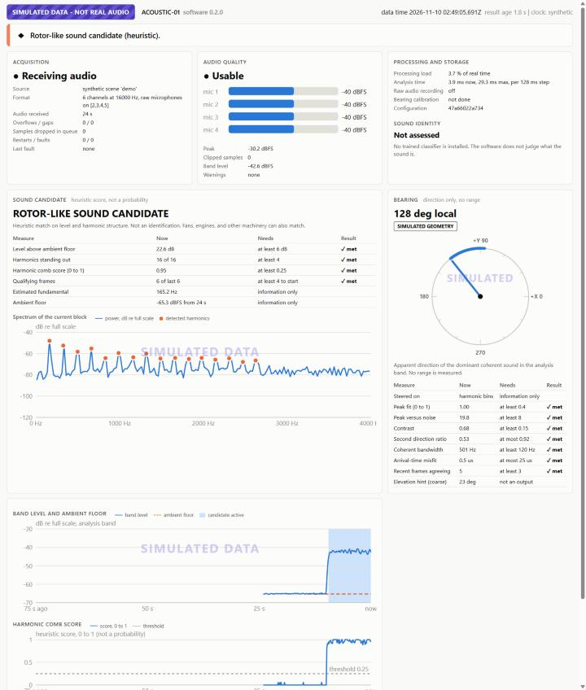
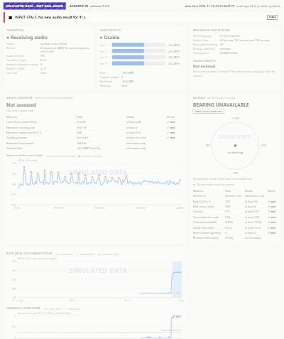

# Operating instructions

Revision B, software 0.2.2. For installation see `README.md`.

## 1. Three modes, always stated

The sensor runs in exactly one mode and you must name it. The mode is printed at start, shown as a badge on every page state, and stored in every event and recording.

| Mode | Command | Input | Badge |
|---|---|---|---|
| Live | `python -m pasensor run --mode live` | The microphone array | LIVE AUDIO (solid) |
| Replay | `python -m pasensor run --mode replay --wav <file>` | A recording made earlier | RECORDING REPLAY (dashed outline) |
| Simulated | `python -m pasensor run --mode simulated` | A synthetic scene | SIMULATED DATA - NOT REAL AUDIO (striped), with a watermark on every chart |

Useful options: `--config <file>`, `--port 8765`, `--no-server`, `--duration <seconds>`, `--event-log <file>`, `--observation-log <file>`, `--record-raw <folder>`, `--label key=value`, `--log-file <file>`. Replay adds `--replay-speed max` and `--exit-when-done`. Simulated adds `--scenario demo|quiet|flyby|fan`.

Then open http://127.0.0.1:8765 in a browser on the same computer. Stop with Ctrl+C.

## 2. Reading the dashboard



**Top bar.** Mode badge, node name, software version, the time of the newest audio, the age of the newest result, and where the clock came from.

**Headline.** One sentence that says what matters most right now. Its left edge and symbol show severity: filled circle for normal, diamond for a candidate, triangle for a warning, square for a fault. Flags on the right list every active condition (for example CLIPPING, OVERFLOW, STALE, RAW RECORDING ON, POLARITY SUSPECT).

**Acquisition.** Whether audio is arriving, from what, in what format, how much, and how many samples were lost. "Overflows / gaps" and "Samples dropped in queue" should stay at zero. "Restarts / faults" counts recoveries.

**Audio quality.** Whether the current block is usable, the level of each of the four microphones, peak, and clipping. One bar much shorter than the others means a blocked or failed microphone.

**Processing and storage.** Processing load as a share of real time, whether raw recording is on, whether a bearing calibration is accepted, and the first characters of the configuration hash.

**Sound identity.** "Not assessed" unless a trained model is installed. The heuristic never fills this in.

**Sound candidate.** Whether a rotor-like sound candidate is active, and the evidence: each criterion with its current value, what it needs, and met or not met. Below that, the spectrum of the current block with the detected harmonics marked. If no candidate is active, the caption says which criteria failed.

**Bearing.** A dial in the array's own frame: 0 degrees is +X, 90 is +Y. A needle appears only when a bearing passed every check in the current block. Dots on the rim are the last 30 seconds of bearings, fading with age. Badges say UNCALIBRATED or SIMULATED GEOMETRY when they apply. When there is no bearing the card says BEARING UNAVAILABLE and lists the reasons in words. The table lists every quality measure with its threshold.

There are no range rings and no position. The array measures direction only.

**Band level and ambient floor, harmonic score.** The last 75 seconds. The shaded band marks when a candidate was active. Move the pointer over a chart to read values.

**Candidate events.** Newest first, with mode, duration, evidence, mean bearing, and the share of the event with no bearing. The list lives in memory. Use `--event-log` to keep it.

### What the states mean

| Headline | Meaning | What to do |
|---|---|---|
| Starting | Waiting for the first full block | Wait |
| Measuring the ambient floor | First 10 s. No candidates are raised yet | Keep the area quiet if you can |
| Listening. No candidate | Normal | |
| Rotor-like sound candidate (heuristic) | Level and harmonic structure match | Look and listen. Check the bearing card. This is not an identification |
| Samples were lost (overflow) | The driver or the computer dropped audio | If it repeats, close other programs or shorten the USB path |
| AUDIO FAULT: ... | Clipping, a dead or duplicate channel, silence, or invalid numbers | Check the cable, the Windows input level, and the microphones |
| ACQUISITION FAULT / RECONNECTING | The device is missing or stopped | Check the USB cable. The sensor keeps retrying |
| INPUT STALE | No new result for 2.5 s although nothing reported a fault | Everything measured is removed from the page. Check the computer load |
| STOPPED AFTER REPEATED FAULTS | Five software faults in a minute | Read the log file, restart, report the fault |
| DASHBOARD LOST CONTACT | The page cannot reach the sensor process | The sensor was closed or crashed. Nothing on the page is current |



## 3. Logs and files

| Output | Option | Content | Audio? |
|---|---|---|---|
| Event log | `--event-log events.jsonl` | Candidate onsets and completed candidates with evidence and bearing statistics. Health records for faults, overflows, and restarts | No |
| Observation log | `--observation-log obs.jsonl` | One bearing per analysis step while a candidate is active and the bearing is calibrated. Input to `fuse` | No |
| Diagnostic log | `--log-file sensor.log` | Program messages and fault tracebacks. Rotates at 2 MB, five files | No |
| Raw recording | `--record-raw <folder>` | Six-channel 16-bit WAV files, rotated every 10 minutes, each with a `.json` sidecar | **Yes** |

Every record names the mode, the node, and the configuration hash.

## 4. Raw recording, privacy, and retention

Raw audio is saved only when you pass `--record-raw` or run `python -m pasensor record`. The console prints a notice and the dashboard shows RAW RECORDING ON.

- Recordings can contain voices. Tell people on site before you record. Check what your local law requires.
- Record what a test needs and no more.
- Each file's sidecar holds its SHA-256, start time, any gaps, the configuration hash, and the labels you gave. Keep the sidecar with the file. Replay and calibration read it.
- Files are never overwritten. Recording stops by itself if free disk space falls below `recording.min_free_gb`.
- Six channels use about 690 MB per hour.
- Delete on a schedule. Proposed: 30 days unless a test plan needs longer.

```powershell
python -m pasensor purge --dir recordings\site1 --older-than-days 30            # lists what would go
python -m pasensor purge --dir recordings\site1 --older-than-days 30 --confirm  # deletes, permanently
```

`purge` touches only WAV files that have this software's sidecar.

## 5. Replay

```powershell
python -m pasensor run --mode replay --wav recordings\site1\ACOUSTIC-01_20261109T180000Z_001.wav
python -m pasensor run --mode replay --wav <file> --replay-speed max --no-server --exit-when-done --event-log replay.jsonl
```

Replay uses the recording's own clock from the sidecar, so the same file and configuration always give the same events. A replay that hits a fault stops as FAILED. It is never restarted behind your back. Replay shows bearings only under an accepted calibration, like live mode.

## 6. Commissioning commands

| Command | Use |
|---|---|
| `python -m pasensor devices` | List capture devices and find the six-channel endpoint |
| `python -m pasensor record --seconds 20 --out-dir <folder> --label k=v` | Make a labelled test recording |
| `python -m pasensor chanmap` | Tap test: which channel is which microphone |
| `python -m pasensor chaninfo --wav <file>` | Level and delay of every capture channel |
| `python -m pasensor calibrate --manifest <json> --out <record>` | Build the bearing calibration record |
| `python -m pasensor evaluate --manifest <json> --out <name>` | Event-level metrics on labelled recordings |
| `python -m pasensor fuse --site <json> --observations a.jsonl b.jsonl` | Multi-node estimates |
| `python -m pasensor train ...`, `make-synthetic-dataset ...` | Classifier workflow |

Procedures that use them: `TEST_PROCEDURES.md`.

## 7. Configuration

Copy `config\node.example.json` to `config\node.json` and edit the copy. The sensor uses `config\node.json` when it exists. Unknown settings and out-of-range values stop the program with the name of the setting.

Settings you will touch: `node_id`, `device.name_contains`, `device.raw_indices`, `array.geometry_m`, `array.temperature_c`, and, after HB-5, the `calibration` block printed by the `calibrate` command. To see a bearing before calibration, for commissioning only, set `calibration.show_uncalibrated_bearing` to true. The page then marks it UNCALIBRATED.

Keep one configuration file per physical unit and mount. Keep the old file whenever you change one.

## 8. Security

- The dashboard listens on 127.0.0.1 only. Other computers cannot reach it. There is no option to change that.
- It is read-only. It refuses anything but GET and HEAD.
- It refuses requests whose Host header is not the loopback address, which stops a web page in the same browser from reading it through DNS rebinding.
- The page loads nothing from the internet and runs under a strict content security policy.
- The program opens no outbound connections. It works with networking disabled.
- Model files are plain JSON. The loader does not unpickle anything.
- The firmware tools from the manufacturer are separate programs. Get them only from the manufacturer's repository.
- Dependencies are NumPy and sounddevice. `requirements-lock.txt` lists the exact versions used in verification.

## 9. Troubleshooting

| Problem | Likely cause and fix |
|---|---|
| "No input device name contains 'XVF3800'" | Wrong firmware (I2S), cable in the wrong socket, or the device has another name. Run `devices`, then set `device.name_contains` or pass `--device <index>` |
| "no endpoint offers 6 input channels" | Two-channel firmware, or Windows is exposing two channels. See `firmware/PROVISIONING.md` section 8 |
| Bearing never appears in live mode | No accepted calibration (badge UNCALIBRATED). Or the sound is a tone, too weak, or reflected: read the reasons on the bearing card |
| Candidate never appears for an obvious source | The source was already sounding at start-up, or it is less than 6 dB above ambient. Read the evidence table |
| Candidates from the computer's own fan | Move the computer farther away (HB-6) |
| Overflows | Close other audio programs, avoid USB hubs, check processing load |
| A file cannot be opened, with a very long path in the message | Windows path limit. Move the project to a short folder such as `C:\PAS` |
| Port 8765 in use | Pass `--port` with another number |
